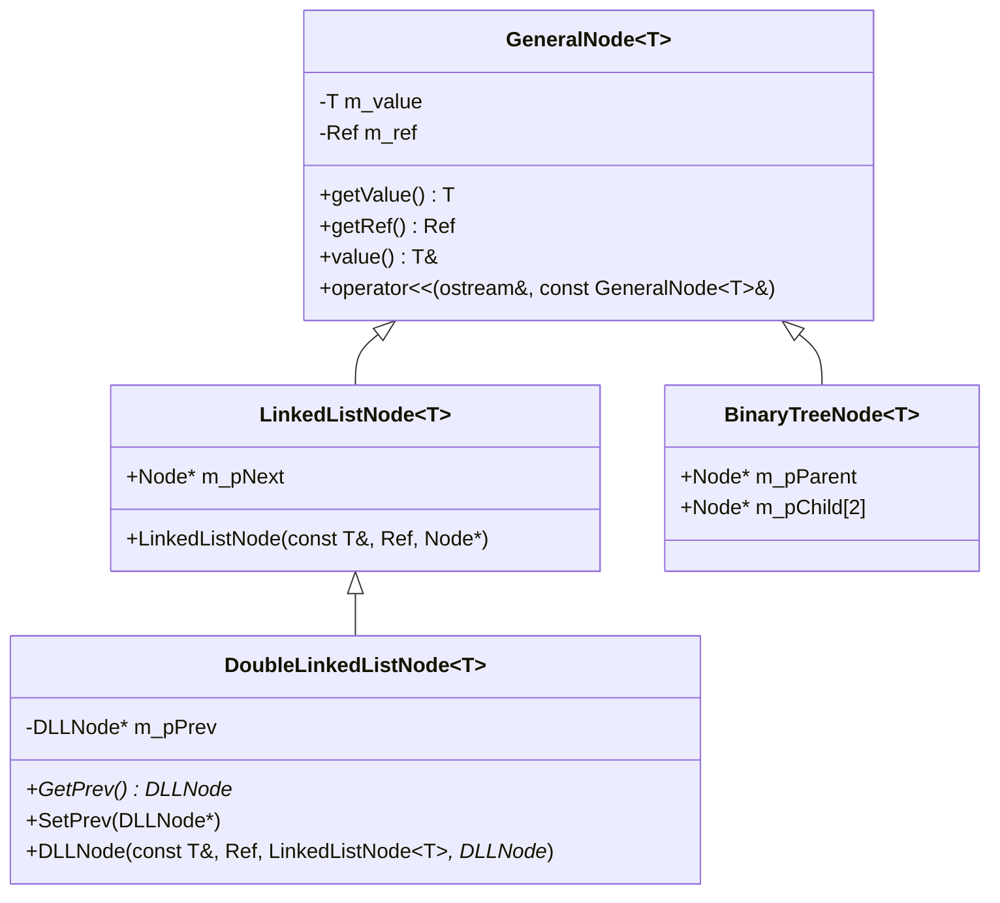
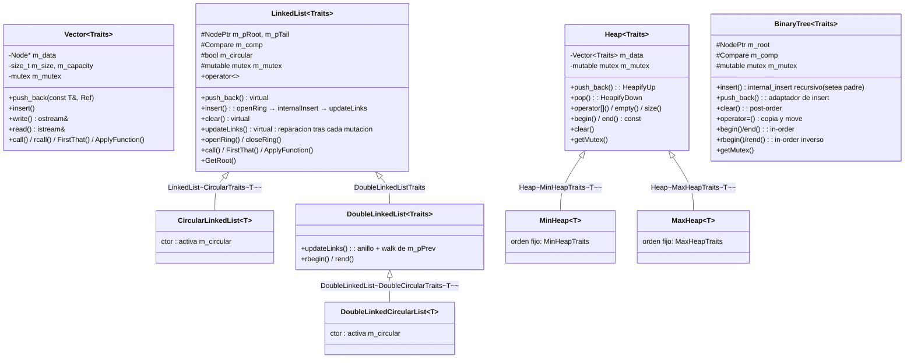
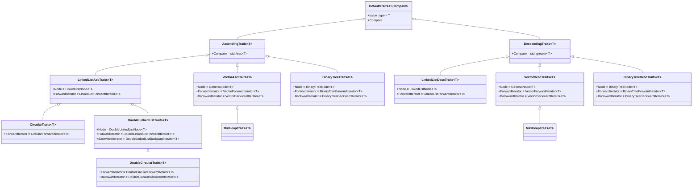
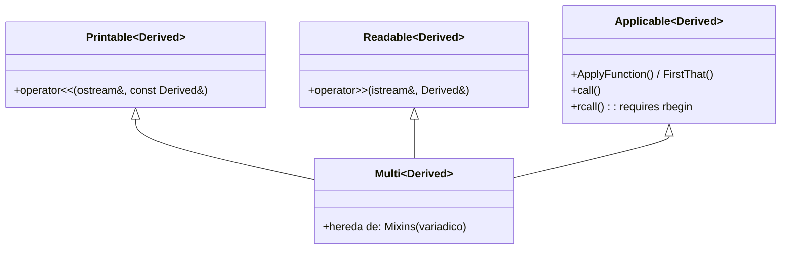
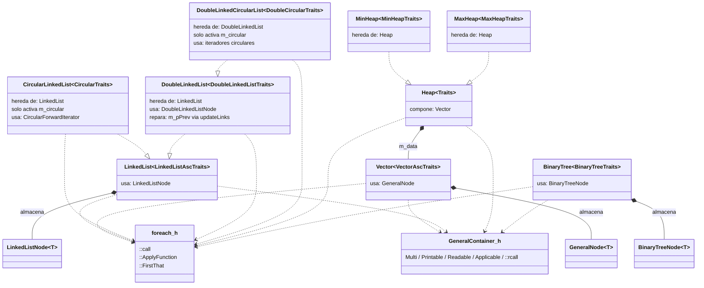

# Jerarquías de clases del curso

## 1 · Nodos

## 2 · Iteradores (CRTP)

```mermaid
classDiagram
    class GeneralIterator~Derived,T~ {
        #pointer m_ptr
        +GeneralIterator(pointer)
        +operator*() value_type&
        +operator==(const Derived&) bool
        +operator!=(const Derived&) bool
    }
    class VectorForwardIterator~T~ {
        +operator++()
    }
    class VectorBackwardIterator~T~ {
        +operator++()
    }
    class LinkedListForwardIterator~T~ {
        +operator++()
    }
    class CircularForwardIterator~T~ {
        -NodePtr m_start
        +operator++()
    }
    class DoubleLinkedListForwardIterator~T~ {
        +operator++()
    }
    class DoubleLinkedListBackwardIterator~T~ {
        +operator++()
    }
    class DoubleCircularForwardIterator~T~ {
        -NodePtr m_start
        +operator++()
    }
    class DoubleCircularBackwardIterator~T~ {
        -NodePtr m_start
        +operator++()
    }
    class BinaryTreeForwardIterator~T~ {
        +operator++() : sucesor in-order via m_pParent
    }
    class BinaryTreeBackwardIterator~T~ {
        +operator++() : predecesor via m_pParent
    }
    GeneralIterator~Derived,T~ <|-- VectorForwardIterator~T~
    GeneralIterator~Derived,T~ <|-- VectorBackwardIterator~T~
    GeneralIterator~Derived,T~ <|-- LinkedListForwardIterator~T~
    GeneralIterator~Derived,T~ <|-- CircularForwardIterator~T~
    GeneralIterator~Derived,T~ <|-- DoubleLinkedListForwardIterator~T~
    GeneralIterator~Derived,T~ <|-- DoubleLinkedListBackwardIterator~T~
    GeneralIterator~Derived,T~ <|-- DoubleCircularForwardIterator~T~
    GeneralIterator~Derived,T~ <|-- DoubleCircularBackwardIterator~T~
    GeneralIterator~Derived,T~ <|-- BinaryTreeForwardIterator~T~
    GeneralIterator~Derived,T~ <|-- BinaryTreeBackwardIterator~T~
```

> **Nota:** `DoubleLinkedListForwardIterator<T>` es un alias de
> `LinkedListForwardIterator<T>`, y `DoubleCircularForwardIterator<T>` un alias
> de `CircularForwardIterator<T>`: el recorrido forward de la lista doble y de
> la doble-circular es idéntico al de sus versiones simples, por lo que se
> reutiliza la implementación en lugar de duplicar clases. Los iteradores del
> árbol viven en `GeneralTraits.h` y sirven para cualquier árbol cuyos nodos
> hereden de `BinaryTreeNode`.

## 3 · Contenedores

> **Nota:** la lista y el vector ya no definen `operator<`, `operator>>`,
> `call`, `FirstThat` ni `ApplyFunction`: todo viene de los mixins de
> `GeneralContainer.h`. Las derivadas solo heredan (estilo `MinHeap`) y
> `rcall` está disponible para las que tienen `rbegin` mediante el
> `::rcall` libre.

## 4 · Traits

## 5 · Mixins (GeneralContainer.h)

> **Nota:** cada contenedor declara su propia cadena
> `Multi<Contenedor<Traits>, Printable, Readable, Applicable>` y las clases
> derivadas la heredan de su base. `::rcall` es libre y opera sobre el tipo
> real del contenedor, por lo que también sirve para derivadas con
> `rbegin` (DLL, DoubleLinkedCircularList, BinaryTree).

## 6 · Composición

